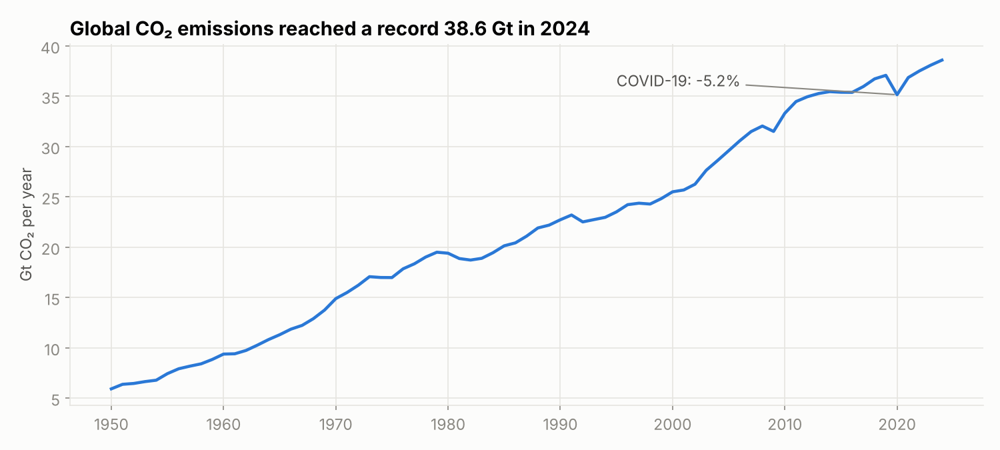
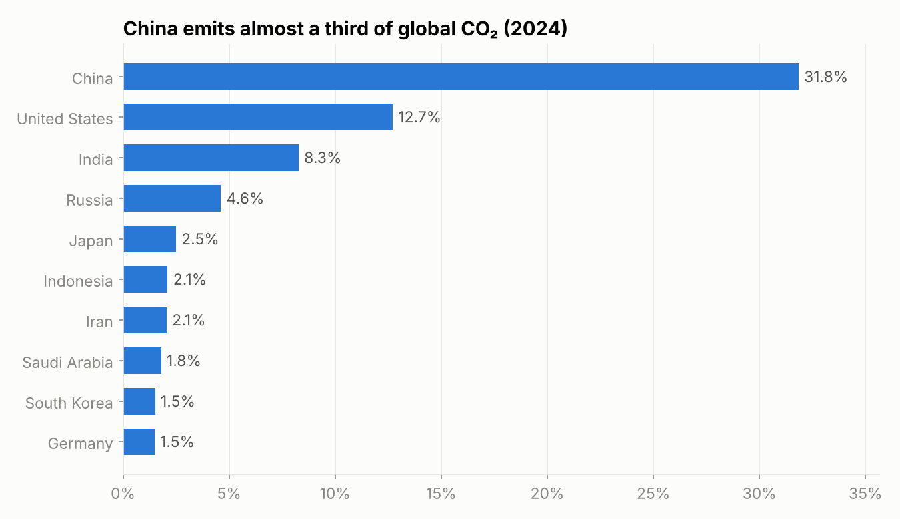
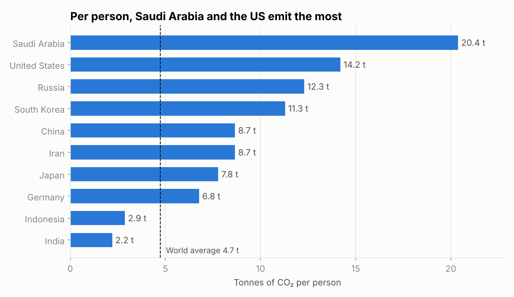
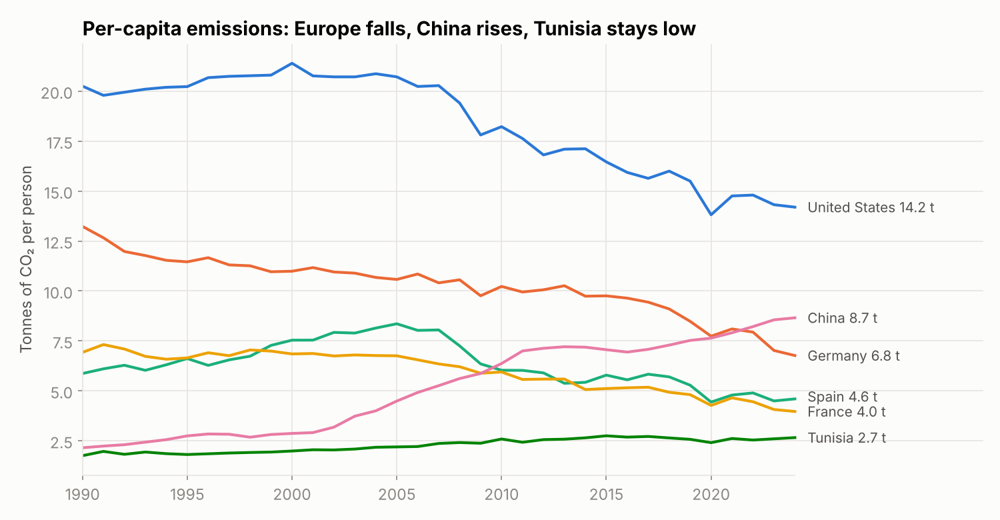
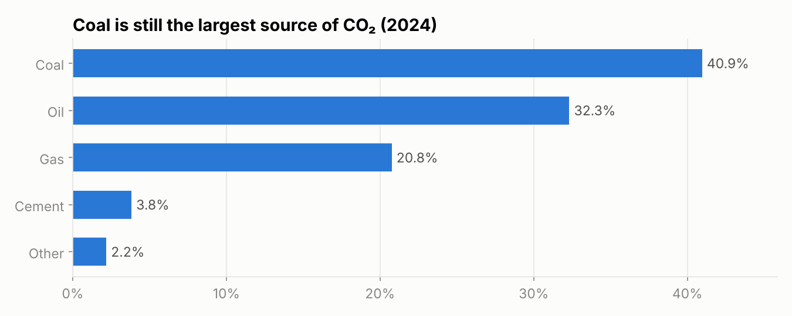

# CO₂ emissions, 1950–2024

An exploratory analysis of 75 years of CO₂ emissions for 218 countries, with a closer look at Europe, Spain and Tunisia. I started this project while learning Tableau with this dataset and wanted to go further in Python.

The full analysis is in the notebook: [`co2_emissions_analysis.ipynb`](co2_emissions_analysis.ipynb).

**Data:** [Our World in Data – CO₂ and Greenhouse Gas Emissions](https://github.com/owid/co2-data) (CC BY 4.0). Fossil and industrial CO₂, in million tonnes.

## Questions

1. How have global emissions changed since 1950?
2. Which countries emit the most today, in total and per person?
3. Are European countries really reducing their emissions? Where do Spain and Tunisia stand?
4. Which fuels are responsible?

## Main results

Global emissions are still rising. They are 6.5 times higher than in 1950 and 70% higher than in 1990, with a new record of 38.6 Gt in 2024. The only real drop was in 2020 with COVID (−5.2%), and it was fully recovered the following year.



Emissions are very concentrated: ten countries produce 69% of the total, and China alone 32%, more than the United States, India and Russia combined.



The per-person view changes the picture. India is the third largest emitter, but with 2.2 tonnes per person it is below the world average (4.7 t). Someone living in Saudi Arabia emits about nine times more.



Europe shows that large reductions are possible, while emerging economies are catching up:

| Country | Total CO₂, change since 1990 | Per person in 2024 |
|---------|------------------------------|--------------------|
| Germany | −46% | 6.8 t |
| France | −33% | 4.0 t |
| Spain | −4% (after a peak in 2005) | 4.6 t |
| Tunisia | ×2.2 | 2.7 t |
| China | ×4.9 | 8.7 t |



Coal (41%) and oil (32%) still account for almost three quarters of emissions, which makes coal the first lever to act on.



## Limits

These are territorial emissions: CO₂ emitted to produce goods imported from elsewhere is counted in the producing country. The data covers CO₂ only (no methane), and the latest year may still be revised by the source.

## Run it

```bash
pip install -r requirements.txt
jupyter notebook co2_emissions_analysis.ipynb
```

The data is downloaded automatically the first time.
